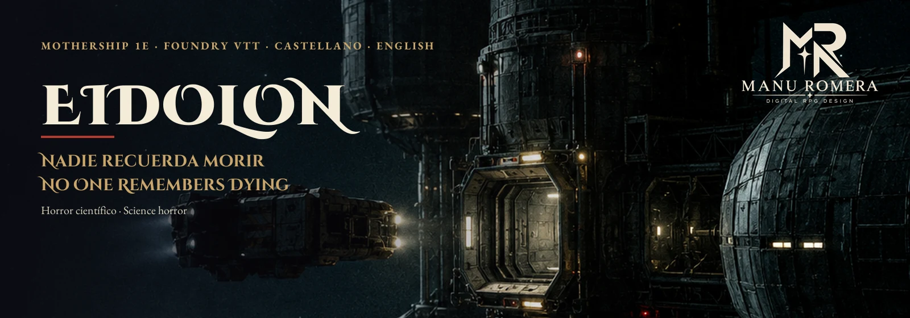
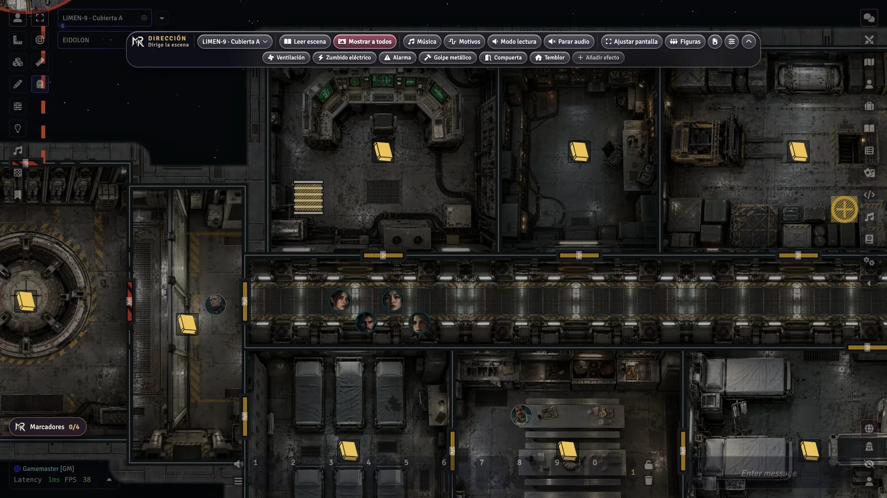
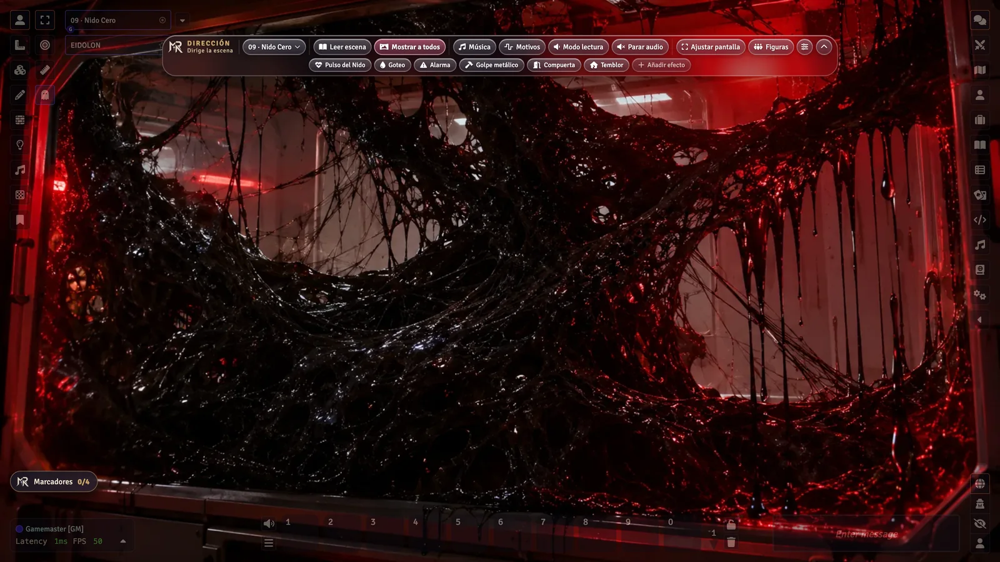
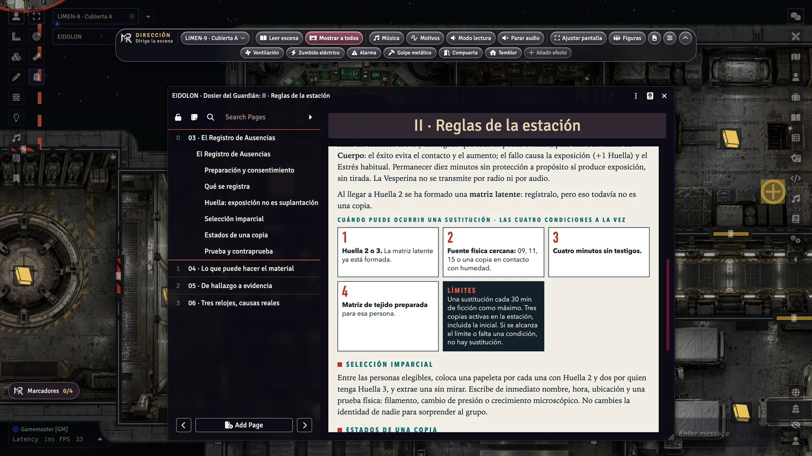
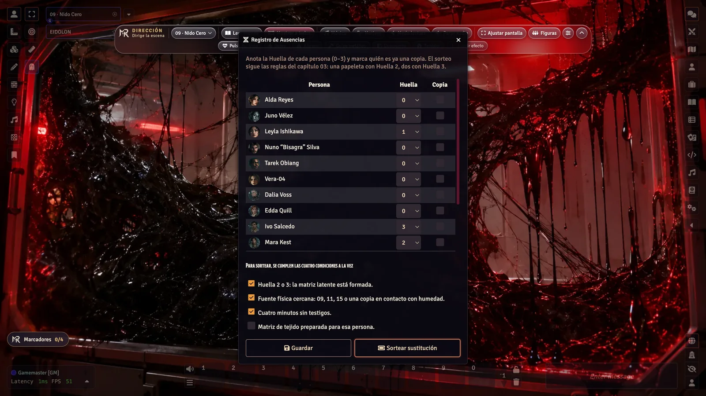
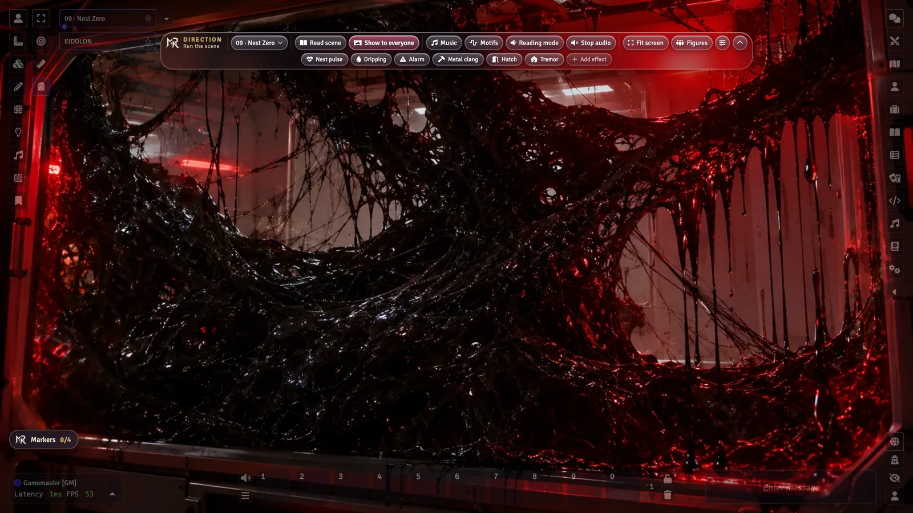
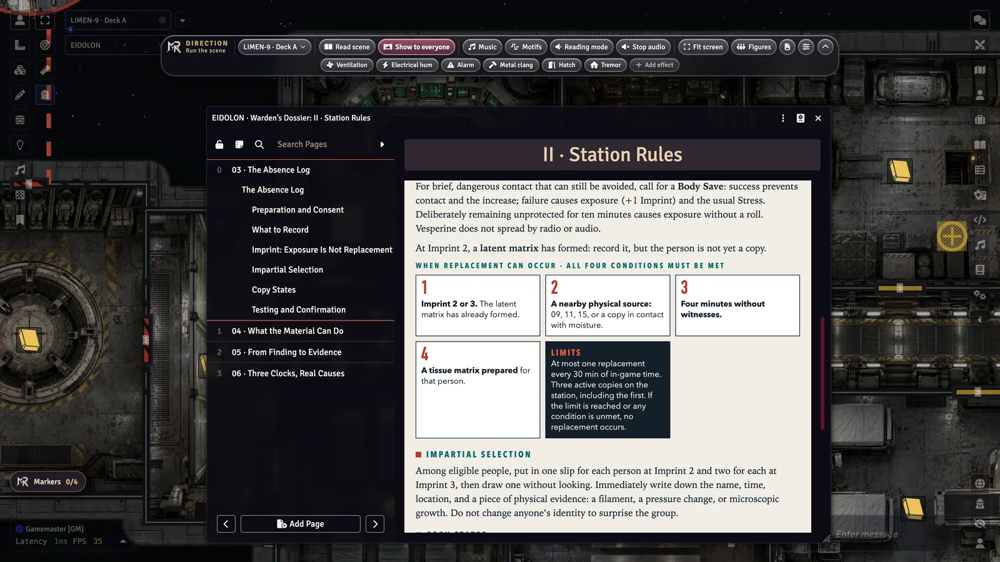
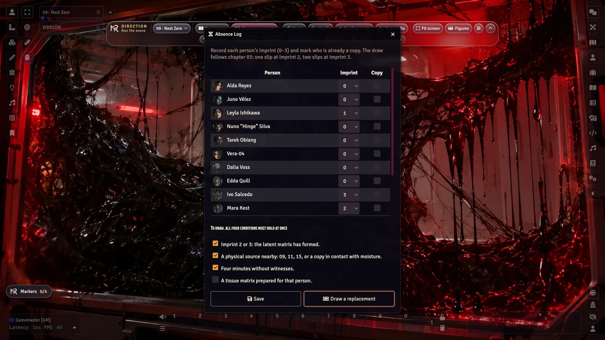

  

  
  
  
  
  
  
  

<h3 align="center">Un contrato de laboratorio. Doscientos gramos de un material que recuerda. Y supervivientes que no saben que ya los han sustituido.</h3>
<h3 align="center">A lab contract. Two hundred grams of a material that remembers. And survivors who don’t know they have already been replaced.</h3>

  <b>🇪🇸 <a href="#-castellano">Castellano</a></b> &nbsp;·&nbsp; <b>🇬🇧 <a href="#-english">English</a></b> 
  Un solo módulo con la aventura completa en los dos idiomas · One module, the complete adventure in both languages

> [!IMPORTANT]
> **Necesita · Requires:** el sistema **[Mothership](https://github.com/Futil/foundry-mothership)** (`mosh`) y el módulo **[MR- Dirección](https://github.com/ManuRomera/mr-direccion)**. Manifiestos y pasos en [Requisitos](#requisitos) · Manifests and steps in [Requirements](#requirements).

---

## 🇪🇸 Castellano

  <a href="https://github.com/ManuRomera/mr-eidolon/releases/latest"><b>⬇️ Descargar</b></a> &nbsp;·&nbsp;
  <a href="https://github.com/ManuRomera/mr-eidolon/releases/latest/download/EIDOLON-ES-Dosier-del-Guardian.pdf"><b>📖 Dosier del Guardián (PDF)</b></a> &nbsp;·&nbsp;
  <a href="#requisitos"><b>🧩 Requisitos</b></a> &nbsp;·&nbsp; <a href="#instalar"><b>⚡ Instalar</b></a>

<b>Horror científico · investigación · paranoia · Mothership 1e · Foundry VTT v13</b> 3–6 jugadores · una sesión de 2 horas

### La aventura

La tripulación de la *Viuda* acepta un contrato de laboratorio en la estación **LIMEN-9**: repetir cuatro ensayos sobre la **Vesperina**, un material que se repara solo, y volver con una muestra sellada de 200 g. Paso a paso, los resultados llevan de un material extraordinario al organismo que lo segrega, a unas copias humanas que no saben que lo son y a una corporación que lo sabía desde el principio.

- **Paranoia con reglas, no con caprichos.** El **Registro de Ausencias** decide quién puede ser una copia: exposición (Huella 0–3), tiempo, testigos y un sorteo a ciegas. Una sustitución exige cuatro condiciones a la vez y siempre deja una prueba física.
- **Ciencia de verdad.** Cuatro hipótesis, cuatro ensayos HERMES, cuatro niveles de evidencia y tres relojes que solo avanzan por causas descritas. Cada conclusión importante tiene tres caminos de entrada.
- **Ningún final impuesto.** Cuatro salidas legítimas y cuatro finales abiertos; ninguno depende de que el Guardián lo permita.

### Qué trae el módulo

| | |
|---|---|
| 📖 **Dosier del Guardián** | El libro entero como diarios: 14 capítulos, 17 salas, los ocho supervivientes, los bloques gráficos del PDF (cronología, ensayos, relojes, salidas), la **Pantalla del Guardián** revisada con la Guía de supervivencia 1.2 y un **Registro de Ausencias** editable. |
| 🗺️ **Planos de las cubiertas** | Dos cubiertas compuestas con plantas cenitales de cada sala, con **muros, puertas y puertas de carga selladas**, notas de sala enlazadas a su página y escalera y trampillas que **llevan los tokens de una cubierta a otra**. Versiones rotuladas de tripulación y del Guardián como imágenes de diario. |
| 🎬 **Escenas de imagen** | Nueve escenas a pantalla completa (Nido Cero, Morgue, Reactor, Hangar…) con lectura, música, efectos, reparto y documentos listos en **MR- Dirección**. |
| 🧬 **Registro de Ausencias** | Anota la Huella de cada persona, marca las copias y haz el **sorteo imparcial de sustitución** (una papeleta con Huella 2, dos con Huella 3, máximo tres copias), que llega en privado al Guardián. |
| 🧑‍🚀 **Actores** | 6 pregenerados con características, habilidades, equipo, respuesta al trauma y su vínculo y secreto confidenciales; 8 supervivientes y 2 amenazas, todos con retrato y token redondo. |
| 📄 **10 documentos de mesa** | Los papeles de NÓXUM como imagen y con su texto. |
| 🎲 **Tablas y macros** | Pulsos de eventos, Incidentes, Primera copia latente; macros para el sorteo y el Registro. |
| 🎧 **Banda sonora** | 10 pistas y 15 efectos originales (síntesis de la casa, misma licencia), con motivos de tensión, horror, huida, exploración y epílogo. |

  
  
  
  

### PDF

| | |
|---|---|
| Dosier del Guardián (A4, 26 págs.) | [EIDOLON-ES-Dosier-del-Guardian.pdf](https://github.com/ManuRomera/mr-eidolon/releases/latest/download/EIDOLON-ES-Dosier-del-Guardian.pdf) |
| Pregenerados (anverso y dorso) + 10 documentos | [EIDOLON-ES-Fichas-y-documentos.pdf](https://github.com/ManuRomera/mr-eidolon/releases/latest/download/EIDOLON-ES-Fichas-y-documentos.pdf) |
| Planos A3 (tripulación + Guardián) | [EIDOLON-ES-Planos-A3.pdf](https://github.com/ManuRomera/mr-eidolon/releases/latest/download/EIDOLON-ES-Planos-A3.pdf) |

### Requisitos

| | Qué es | ¿Obligatorio? | Enlace | Manifiesto |
|---|---|---|---|---|
| 🧑‍🚀 **Foundry VTT v13** | El programa | **Sí** | [foundryvtt.com](https://foundryvtt.com) | — |
| 🪐 **Mothership** (`mosh`) | El sistema de juego | **Sí** | [Futil/foundry-mothership](https://github.com/Futil/foundry-mothership) | `https://raw.githubusercontent.com/Futil/foundry-mothership/0.6.1/system.json` |
| 🎬 **MR- Dirección** | La barra del Guardián (escenas, música, efectos, relojes) | **Sí** | [ManuRomera/mr-direccion](https://github.com/ManuRomera/mr-direccion) | `https://github.com/ManuRomera/mr-direccion/releases/latest/download/module.json` |
| 🇪🇸 **MR- Mothership en español** | El sistema en castellano y la tabla de parches ilustrada | Recomendado si juegas en castellano | [ManuRomera/mr-mothership-es](https://github.com/ManuRomera/mr-mothership-es) | `https://github.com/ManuRomera/mr-mothership-es/releases/latest/download/module.json` |
| 🔤 **Babele** | Lo necesita MR- Mothership en español | Solo con el anterior | [riccisi/foundryvtt-babele](https://gitlab.com/riccisi/foundryvtt-babele) | `https://gitlab.com/riccisi/foundryvtt-babele/raw/master/module/module.json` |

> Mothership y MR- Dirección se pueden buscar también por su nombre en *Instalar sistema* / *Instalar módulo*. Si instalas EIDOLON por manifiesto, Foundry te ofrece instalar MR- Dirección en el mismo paso.

### Instalar

1. **Sistema:** en Foundry v13, *Sistemas de juego → Instalar sistema*, pega `https://raw.githubusercontent.com/Futil/foundry-mothership/0.6.1/system.json` (o busca «Mothership»).
2. **Módulos:** *Módulos de complemento → Instalar módulo*, pega el manifiesto de EIDOLON:
   `https://github.com/ManuRomera/mr-eidolon/releases/latest/download/module.json`
   Foundry te pedirá instalar también **MR- Dirección**; acepta. Si no te lo pide, instálala con `https://github.com/ManuRomera/mr-direccion/releases/latest/download/module.json`.
3. **Si juegas en castellano:** instala también **MR- Mothership en español** (`https://github.com/ManuRomera/mr-mothership-es/releases/latest/download/module.json`) y **Babele**, y pon Foundry en *Español*.
4. **Mundo:** crea un mundo con el sistema Mothership y activa **MR- EIDOLON** y **MR- Dirección** (y la traducción). En un **mundo vacío** la aventura se importa sola en el idioma de Foundry; puedes cambiarlo en *Configurar ajustes → MR- EIDOLON* y reimportar desde *Configuración → MR- EIDOLON → Importar la aventura*.

### Créditos y aviso

- **Mothership** es una marca de Tuesday Knight Games. EIDOLON es una obra independiente y **no oficial**, compatible con Mothership 1e. Las referencias de reglas citan la Guía de supervivencia del jugador 1.2.
- Historia y diseño: Manu Romera. Maquetación, planos, módulo de Foundry y edición en inglés hechos con ayuda de IA (Claude, Codex) y revisados por el autor.
- **Imágenes generadas con IA** (ChatGPT y el modelo local Z-Image) y retocadas por el autor. Música y efectos: síntesis original de [MR- Nádir](https://github.com/ManuRomera/mr-nadir).
- Licencia: **CC BY-NC-SA 4.0** — ver [LICENSE](LICENSE) y [NOTICE.md](NOTICE.md).

---

## 🇬🇧 English

  <a href="https://github.com/ManuRomera/mr-eidolon/releases/latest"><b>⬇️ Download</b></a> &nbsp;·&nbsp;
  <a href="https://github.com/ManuRomera/mr-eidolon/releases/latest/download/EIDOLON-EN-Wardens-Dossier.pdf"><b>📖 Warden’s Dossier (PDF)</b></a> &nbsp;·&nbsp;
  <a href="#requirements"><b>🧩 Requirements</b></a> &nbsp;·&nbsp; <a href="#install"><b>⚡ Install</b></a>

<b>Science horror · investigation · paranoia · Mothership 1e · Foundry VTT v13</b> 3–6 players · one 2-hour session

### The adventure

The crew of the *Widow* takes a lab contract on station **LIMEN-9**: repeat four tests on **Vesperine**, a self-repairing material, and come back with a sealed 200 g sample. Step by step the results lead from an extraordinary material to the organism that secretes it, to human copies that don’t know they are copies, and to a corporation that knew all along.

- **Paranoia with rules, not whims.** The **Absence Log** decides who can be a copy: exposure (Imprint 0–3), time, witnesses and a blind draw. A replacement needs four conditions at once and always leaves physical evidence.
- **Real science.** Four hypotheses, four HERMES tests, four levels of evidence and three clocks that move only for stated causes. Every key conclusion has three ways in.
- **No forced ending.** Four legitimate escape routes and four open endings; none depends on the Warden allowing it.

### What’s in the module

| | |
|---|---|
| 📖 **Warden’s Dossier** | The whole book as journals: 14 chapters, 17 keyed rooms, the eight survivors, the graphic blocks of the PDF (timeline, tests, clocks, exits), the **Warden’s Screen** checked against the Player’s Survival Guide 1.2 and an editable **Absence Log**. |
| 🗺️ **Deck plans** | Two decks built from overhead renders of every room, with **walls, doors and sealed cargo doors**, room notes linked to their journal page, and stairs and hatches that **teleport tokens between decks**. Labeled crew and Warden versions as journal images. |
| 🎬 **Image scenes** | Nine full-screen scenes (Nest Zero, Morgue, Reactor, Hangar…) with read-aloud text, music, effects, cast and handouts ready in **MR- Dirección**. |
| 🧬 **Absence Log tool** | Track each person’s Imprint, mark copies and run the **impartial replacement draw** (one slip at Imprint 2, two at Imprint 3, three-copy limit), whispered to the Warden. |
| 🧑‍🚀 **Actors** | 6 pregenerated characters with stats, skills, gear, trauma response and their confidential bond and secret; 8 survivors and 2 threats, all with portraits and round tokens. |
| 📄 **10 handouts** | NOXUM documents as images plus their text. |
| 🎲 **Tables & macros** | Event Pulses, Incidents, First Latent Copy; macros for the draw and the Log. |
| 🎧 **Soundtrack** | 10 original tracks and 15 effects (house synthesis, same license), with motifs for tension, horror, escape, exploration and epilogue. |

  
  
  
  

### PDFs

| | |
|---|---|
| Warden’s Dossier (A4, 26 pp.) | [EIDOLON-EN-Wardens-Dossier.pdf](https://github.com/ManuRomera/mr-eidolon/releases/latest/download/EIDOLON-EN-Wardens-Dossier.pdf) |
| Pregens (front and back) + 10 handouts | [EIDOLON-EN-Characters-and-Handouts.pdf](https://github.com/ManuRomera/mr-eidolon/releases/latest/download/EIDOLON-EN-Characters-and-Handouts.pdf) |
| A3 deck plans (crew + Warden) | [EIDOLON-EN-A3-Deck-Plans.pdf](https://github.com/ManuRomera/mr-eidolon/releases/latest/download/EIDOLON-EN-A3-Deck-Plans.pdf) |

### Requirements

| | What it is | Required? | Link | Manifest |
|---|---|---|---|---|
| 🧑‍🚀 **Foundry VTT v13** | The app | **Yes** | [foundryvtt.com](https://foundryvtt.com) | — |
| 🪐 **Mothership** (`mosh`) | The game system | **Yes** | [Futil/foundry-mothership](https://github.com/Futil/foundry-mothership) | `https://raw.githubusercontent.com/Futil/foundry-mothership/0.6.1/system.json` |
| 🎬 **MR- Dirección** | The Warden’s bar (scenes, music, effects, clocks) | **Yes** | [ManuRomera/mr-direccion](https://github.com/ManuRomera/mr-direccion) | `https://github.com/ManuRomera/mr-direccion/releases/latest/download/module.json` |
| 🇪🇸 **MR- Mothership en español** | Spanish translation of the system, with the illustrated patch table | Only to play in Spanish | [ManuRomera/mr-mothership-es](https://github.com/ManuRomera/mr-mothership-es) | `https://github.com/ManuRomera/mr-mothership-es/releases/latest/download/module.json` |
| 🔤 **Babele** | Needed by MR- Mothership en español | Only with the above | [riccisi/foundryvtt-babele](https://gitlab.com/riccisi/foundryvtt-babele) | `https://gitlab.com/riccisi/foundryvtt-babele/raw/master/module/module.json` |

> You can also search for Mothership and MR- Dirección by name in *Install System* / *Install Module*. When you install EIDOLON from its manifest, Foundry offers to install MR- Dirección in the same step.

### Install

1. **System:** in Foundry v13, *Game Systems → Install System*, paste `https://raw.githubusercontent.com/Futil/foundry-mothership/0.6.1/system.json` (or search for “Mothership”).
2. **Modules:** *Add-on Modules → Install Module*, paste the EIDOLON manifest:
   `https://github.com/ManuRomera/mr-eidolon/releases/latest/download/module.json`
   Foundry will ask to install **MR- Dirección** too; accept. If it doesn’t, install it from `https://github.com/ManuRomera/mr-direccion/releases/latest/download/module.json`.
3. **To play in Spanish:** also install **MR- Mothership en español** (`https://github.com/ManuRomera/mr-mothership-es/releases/latest/download/module.json`) and **Babele**, and set Foundry to *Español*.
4. **World:** create a world with the Mothership system and enable **MR- EIDOLON** and **MR- Dirección**. In an **empty world** the adventure imports itself in your Foundry language; you can change it in *Configure Settings → MR- EIDOLON* and reimport from *Game Settings → MR- EIDOLON → Import the adventure*.

### Credits & notice

- **Mothership** is a trademark of Tuesday Knight Games. EIDOLON is an independent, **unofficial** work compatible with Mothership 1e. Rule references cite the Player’s Survival Guide 1.2.
- Story and design: Manu Romera. Layout, deck plans, Foundry module and US English edition made with AI assistance (Claude, Codex) and reviewed by the author.
- **Images are AI-generated** (ChatGPT and the local Z-Image model) and graded by the author. Music and effects: original synthesis from [MR- Nádir](https://github.com/ManuRomera/mr-nadir).
- License: **CC BY-NC-SA 4.0** — see [LICENSE](LICENSE) and [NOTICE.md](NOTICE.md).
